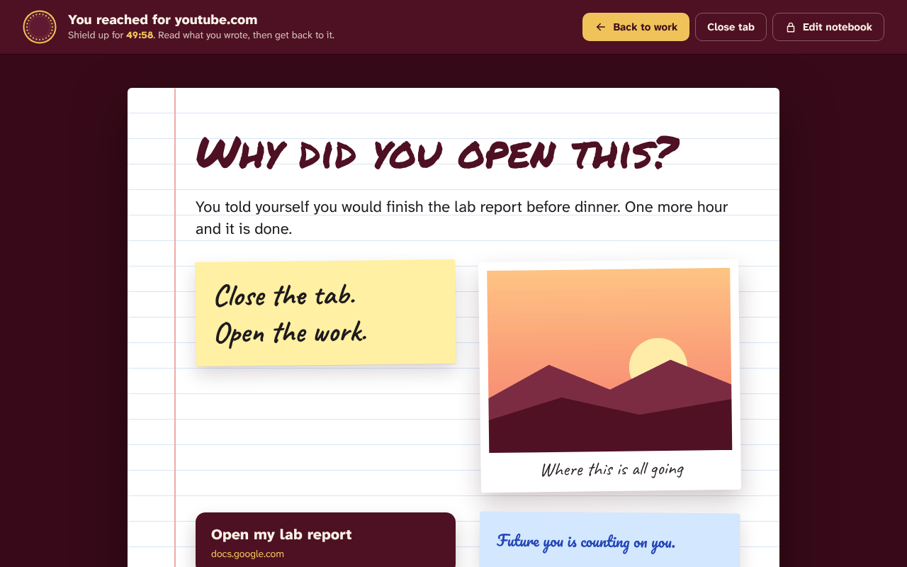

# Gasha ጋሻ



Gasha, which means “shield” in Amharic, protects you from distractions that derail you from your goals. It is a Google Chrome extension that blocks the websites you get “sucked into” through muscle memory, like reaching for your phone while working, which eats up your productive hours.

## What it does

* **Blocks any list of sites.** Add a domain like `youtube.com` to block the whole site and its subdomains, or a path like `reddit.com/r/all` to block only that part. Gasha also catches in page navigation, so moving around inside a site like YouTube cannot slip past it.
* **Opens your notebook instead.** Every blocked site opens a page you design for yourself. Write messages in seven fonts and any color, add sticky notes, YouTube and TikTok videos, photos, and buttons that link to the work you should be doing. Choose lined, grid, dotted, or plain paper in six colors.
* **Focus sessions locked with a password.** Pick 25 minutes, 2 hours, or any length up to 24 hours. While a session runs, nobody can remove sites, edit the notebook, change settings, or end the session early without the password. With no password set, a session simply runs until its timer ends. Five wrong guesses lock the password box for a minute.
* **Hard to switch off in the middle of a session.** While Gasha is locked, Chrome's extensions page and the reset settings page redirect to the notebook.
* **Two blocking modes.** Block sites all the time, or only while a focus session is running.
* **Everything stays on your computer.** The notebook, photos, and settings are saved in Chrome's local extension storage, so they are there every time Chrome starts. There is no account and no server. A backup file can be downloaded from settings and restored later or on another computer.

## Try it on your computer

1. Install [Node.js](https://nodejs.org) 22.18 or newer.
2. Open a terminal in this folder and run:
   ```sh
   npm install
   npm run build
   ```
3. Open `chrome://extensions` in Chrome, turn on **Developer mode**, click **Load unpacked**, and choose the `dist` folder.
4. Click the puzzle piece icon in the toolbar and pin Gasha.

While you work on the code, `npm run watch` rebuilds on every save. After a rebuild, click the reload arrow on Gasha's card in `chrome://extensions`.

| Command | What it does |
| --- | --- |
| `npm run build` | Compiles the TypeScript and copies everything Chrome needs into `dist` |
| `npm run watch` | Same as build, then rebuilds whenever a file in `src` changes |
| `npm run typecheck` | Checks types without building |
| `npm run package` | Builds and writes the Chrome Web Store upload to `release/gasha-<version>.zip` |

## Publish it so anyone can install it

1. Run `npm run package`.
2. Go to the [Chrome Web Store Developer Dashboard](https://chrome.google.com/webstore/devconsole), sign in with the Google account you want to publish under, and pay the one time $5 registration fee.
3. Click **New item** and upload the ZIP from the `release` folder.
4. On the **Store listing** tab, paste the text from [`store/listing.md`](store/listing.md) and upload the screenshots and the promo tile from the `store` folder.
5. On the **Privacy** tab, paste the single purpose statement and the permission explanations from `store/listing.md`. For the privacy policy URL, link to [`PRIVACY.md`](PRIVACY.md) on GitHub.
6. Submit for review. Once approved, anyone can install Gasha from its Chrome Web Store page.

To ship an update, raise `version` in `package.json`, run `npm run package` again, and upload the new ZIP on the item's **Package** tab. The build copies the version into the manifest for you.

## How the code is organized

| File | Role |
| --- | --- |
| `src/background.ts` | Service worker. Turns the block list into declarativeNetRequest rules that redirect a blocked page to the notebook before it loads, runs the session timer with `chrome.alarms`, checks the password, and watches tabs for in page navigation and for the extensions page |
| `src/notebook.ts` | The notebook page and its editor |
| `src/popup.ts` | The toolbar popup with the shield timer |
| `src/options.ts` | The settings page |
| `src/shared.ts` | Types, site matching, notebook validation, and the typed message API between the pages and the service worker |
| `src/ui.ts` | Small DOM helpers, icons, and the shield timer drawing |
| `scripts/build.ts` | Compiles, copies the static files, syncs the version, and packs the ZIP |

A few details worth knowing:

* Passwords are never stored. Gasha keeps a PBKDF2 hash with a random salt and checks typed passwords against it.
* Chrome does not send a Referer header from extension pages, and YouTube refuses to play embeds without one. Gasha adds a declarativeNetRequest rule, scoped to its own pages, that sets the header on YouTube and TikTok embeds inside the notebook.
* Everything a page writes goes through the service worker, which checks the lock first. The notebook is cleaned and validated before it is saved, and links only accept `http` and `https` addresses.

## Limits worth knowing

* A Chrome extension can always be removed from the puzzle piece menu. Gasha locks the extensions page during a session to make that harder, but no extension can make it impossible.
* Incognito windows are covered only if **Allow in Incognito** is turned on for Gasha. Settings shows whether it is on and links to the switch.
* Blocking a domain also blocks its subdomains. Blocking `google.com` blocks `docs.google.com` too, so block a path like `google.com/search` if you only want search gone.
* Videos in the notebook keep playing during a session, because you chose them. That is also why editing the notebook is locked while a session runs.
* Removing the extension deletes the notebook and settings. Download a backup first if you want to keep them.

## Credits

The fonts are bundled under their open licenses, which are included in `src/fonts`: Atkinson Hyperlegible Next, Noto Serif Ethiopic, Caveat, Permanent Marker, Bebas Neue, DM Serif Display, Special Elite, and Pacifico.

## License

[MIT](LICENSE)
